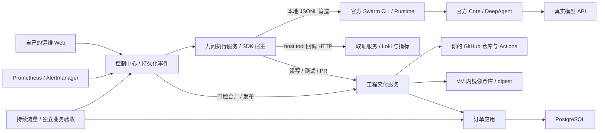

# Jiuwen Ops Lab

一个可以在本地运行、阅读源码和反复实验的真实运维 Agent 项目。我们自己的 Web/API 通过 **官方 JiuwenSwarm Process SDK → Swarm Runtime → Core/DeepAgent** 执行模型与工具循环。

维护对象是独立运行的订单 API + PostgreSQL。一次优惠码空值处理回归会让普通下单返回 500。目标流程：实际告警 → 模型读取实际日志/指标/源码 → 生成修复与回归测试 → 真实 GitHub PR/CI → 按规则合并 → 构建精确提交 → 发布不可变镜像 → 独立验证业务恢复。

**当前：环境和工程交付链已实测通过；真实模型已生成修复与 PR #3，并通过发布后业务合同和新会话复核。首条集成案例含重试，三次独立重置试验正在执行，见 STATUS。**

**当前验收状态请先看 [STATUS](docs/STATUS.md)。模型未配置不代表 Agent 已验证；工程、环境和模型验收分别记录。** 本项目用于受控学习实验，自动操作仅针对你自己的演示仓库与专用 VM。

## 先理解组件



Swarm 和 Core 在执行服务的官方子进程里，不是两个 HTTP 服务。我们的 runner 只做 SDK 调用、事件持久化映射、工具回调、取消与错误处理，没有编写另一个模型循环。首版是单 Agent 按阶段执行，不声称使用 Swarm 多 Agent 团队。

详细阅读：[D1 HTML 设计快照](docs/design.html) · [官方九问接线](docs/JIUWEN.md) · [运行与复现](docs/RUNBOOK.md) · [权限和版本链](docs/BOUNDARIES.md) · [验收记录](docs/STATUS.md)。

## Mac 快速开始

前置：Apple Silicon Mac、Python 3.11+、Git、Lima 2.1+；完整 GitHub 流程还需要 GitHub CLI 登录和自己仓库的写权限。模型 Key 只在本地配置。

1. **Fork 或通过模板创建自己的仓库**，再 clone 自己的地址。PR、合并、构建都发生在自己的仓库，不要把写入目标仍留成作者仓库。
2. 准备本地配置和 GitHub 凭证：

```bash
git clone https://github.com/YOUR_NAME/jiuwen-ops-lab.git
cd jiuwen-ops-lab
scripts/lab init --github
# 修改 .local/lab.env 中的 GITHUB_REPOSITORY=YOUR_NAME/jiuwen-ops-lab
```

3. 创建和启动专用 VM（4 vCPU / 10 GiB / 60 GiB 按需磁盘），传入代码和明确的本地配置：

```bash
scripts/lab vm-create
scripts/lab vm-sync
scripts/lab vm-up
```

4. 打开 `http://127.0.0.1:18780`；业务 API 在 `http://127.0.0.1:18080/docs`。用 `scripts/lab token` 获取本地工作台操作令牌。
5. 验证正常基线，再制造故障：

```bash
scripts/lab baseline
scripts/lab fault
# 监控会自动创建事件，也可以在工作台立即创建调查事件。
```

6. 编辑 `.local/model.env`，填入供应商兼容地址、模型名和 Key，再应用：

```bash
scripts/lab configure-model
scripts/lab smoke
```

配置为空时，九问执行服务仍可查询真实 CLI 协议能力，但**不会领取模型任务**。事件留在队列；页面明确显示等待模型。第一次运行要下载系统镜像、容器镜像和官方九问源码/依赖，耗时取决于网络。

## Linux / 已有 Docker 主机

不需要 Lima。clone 后运行 `scripts/lab init --github`，编辑 `.local/lab.env`；创建 `.local/runtime.env`：

```bash
printf 'HOST_REPO=%s\nLAB_TRUST_SHA=%s\n' "$PWD" "$(git rev-parse HEAD)" > .local/runtime.env
scripts/lab up
scripts/lab baseline
```

Docker CLI/Compose 需可用。资源建议与 VM 相同。Docker socket 只给可信工程服务；候选代码在一次性容器中运行。当前 Mac VM 路径仅资格验证 ARM64，其他平台需按 STATUS 的实际证据判断。

## 配置和资料

- [`config/model.env.example`](config/model.env.example)：唯一的模型凭证模板，只有 runner 读取。
- [`config/lab.env.example`](config/lab.env.example)：仓库、实验分支、自动模式与恢复窗口。
- [`config/framework.lock.json`](config/framework.lock.json)：官方 Swarm/Core/协议源码固定版本。
- [`compose.yaml`](compose.yaml)：各独立服务、网络、卷和密钥挂载。
- [`scripts/`](scripts/)：VM、部署、故障、CI、配置与验收脚本。
- [`lab/runner.py`](lab/runner.py)：官方 SDK 宿主；[`lab/tools.py`](lab/tools.py)：领域工具 Schema。
- [`lab/control.py`](lab/control.py)：产品状态机；[`lab/delivery.py`](lab/delivery.py)：真实工程动作与版本链。
- [`apps/order_api/`](apps/order_api/)：示例业务；[`contracts/`](contracts/)：独立业务判据。

`.local/` 包含密钥、配置和本次验收原始材料，已整体忽略，不提交。Docker/Compose 配置渲染时也可能展开模型 Key，不要把完整 `docker compose config` 或容器环境转储发布到 issue。

## 仓库与实验分支

`main` 保持可学习的正常系统。`lab-live` 是真实修复 PR 的目标实验分支：故障注入器在该分支提交可控坏版本并部署；Agent 的候选基于事故提交，PR 指向同一分支。注入器不会把补丁、正确行号或故障标签传给 Agent。

可信合同/工作流/Dockerfile 不允许被修复 PR 修改。CI 绑定实际候选与 test-merge 提交，合并后的实际 SHA 再检查并构建。GitHub Actions 生成 AMD64/ARM64 Docker archive；工程服务校验来源/哈希后导入 VM 内 registry，取得 registry digest 并按 digest 发布。不依赖把 GitHub Packages Token 交给模型。

## 常用命令

```bash
scripts/lab vm-status
scripts/lab token
scripts/lab investigate
scripts/lab configure-model
scripts/lab smoke
# VM 内：scripts/lab logs runner / scripts/lab logs delivery
```

完整重置、取消、故障诊断和数据保留见 [RUNBOOK](docs/RUNBOOK.md)。项目不会默认删除 VM、卷、PR 或既有验收记录。

## 许可证

本项目采用 Apache-2.0。官方 Jiuwen 源码在构建时按固定提交下载，保留其上游许可证；不把上游实现冒充为本项目代码。参见 [第三方依据](docs/THIRD_PARTY.md)。
