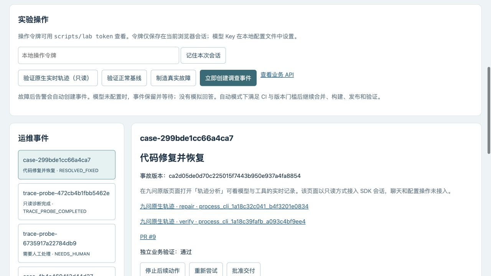
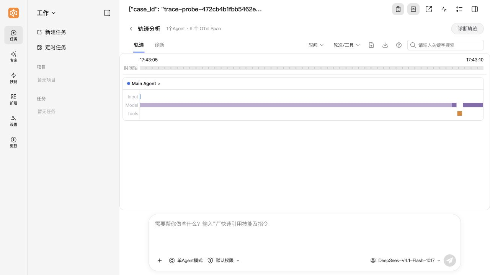
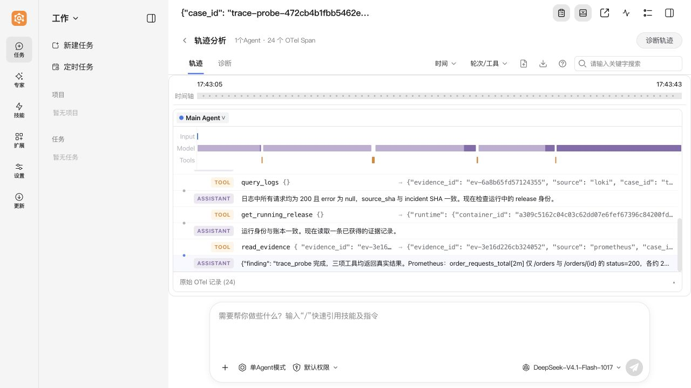
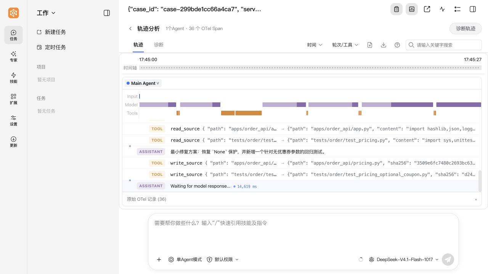
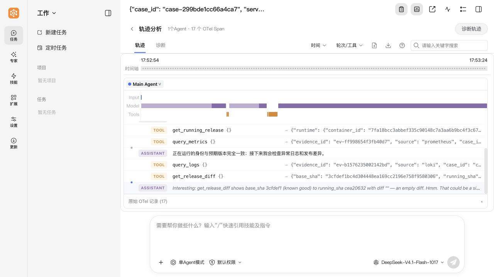

# 原生 WebUI 与运维事件联调实测

2026-10-30，专用 ARM64 Lima VM，真实 `DeepSeek-V4.1-Flash-1017` 模型。最小链路和完整订单案例均已通过；原版页面由浏览器实际打开，在任务运行时观察到增量，截图与原生归档见下方。完整案例无需人工重试。

## 先看结果

| 任务 | 运维事件 | 同一次官方 SDK Session | 最终原生记录 / revision | SDK |
|---|---|---|---|---|
| 只读连通性验证 | `trace-probe-472cb4b1fbb5462e` | `process_cli_1a18c30fde1_0bb38e92f0c2` | 25 / 37 | completed / 0 |
| 真实故障调查与修复 | `case-299bde1cc66a4ca7` | `process_cli_1a18c32c041_b4f3201e0834` | 49 / 73 | completed / 0 |
| 发布后独立复核 | 同上 | `process_cli_1a18c39fafb_a093c4bf9ee4` | 18 / 27 | completed / 0 |

最小探针在运行期间采到 revision `0 → 5 → 11 → 13 → 18 → 20 → 25 → 27 → 32 → 37`。同一个浏览器页面先显示 5 个 Span，后续无需刷新增加到 24 个，最终原生读取器保存 25 条。原生记录包含该 case_id，工具参数与返回可对应工作台中的 `ev-*` 证据。

修复任务在运行期间继续采到 revision `40 → 48 → 50 → 55 → 62 → 63 → 64 → 69 → 73`；复核任务是新的 Session，也在运行期间增长到 revision 27。启动后的初始空库、构建阶段观测服务升级时的短暂读取中断保留在本地采样记录；没有将这些空值改写成成功数据。

## 完整案例的真实交付

- 实际告警创建事件，事故源码 `ca2d05de0d70c225015f7443b950e937a4fa8854`。
- 模型通过工具读日志、指标、版本差异和源码，自行写修复与新增回归测试，并运行真实测试。
- [PR #9](https://github.com/lelezi257/jiuwen-ops-lab/pull/9)，候选 `60cd87a60485e002e17dab162878d83336cb8c2a`，真实 CI 通过后合并为 `cea20632b537196fe07092171762ff897e884e2d`。
- [GitHub 构建 41035953731](https://github.com/lelezi257/jiuwen-ops-lab/actions/runs/41035953731)：AMD64 和 ARM64 均成功；VM 校验 ARM64 产物来源与哈希后发布镜像。
- 实际镜像 `localhost:5000/jiuwen-order@sha256:c80ede06cadbbacd149067cd3b9aa35fd3d382bb8e9cb7e20254727fce9ef139`。
- 独立验证 `verify-f38f43fd41cb46a2`：2×60 秒，无优惠券和有优惠券两条路径分别为每轮 108/108、107/107 次，均成功；直接查 PostgreSQL 的金额与订单数据全部匹配，历史订单和非法输入检查通过。
- 新 SDK Session 只读复核完成后状态 `RESOLVED_FIXED`；repair 1 次、verify 1 次、人工重试 0、控制器错误 0。

这次只验证一个受控应用的空值回归案例。最小探针用于集成验证，完整案例验证真实修复/交付闭环；不将其扩展成生产可靠性或多 Agent 协作结论。

## 截图

工作台中同一事件已恢复，可分别打开 repair / verify 的原生 Session：

原生页面运行中的最小链路：

原生页面中的真实取证工具与返回：

完整修复 Session，实际读取/写入源码与新增测试：

同一事件的新 Session，发布后只读复核：

## 可核查材料

- [Session / 原生 Span / SDK 回执 / 实时 revision 对应](evidence/native-webui/trace-summary.json)
- [完整运维事件与独立业务验证摘要](evidence/native-webui/full-case.json)
- [原版前端来源核对](evidence/native-webui/frontend-provenance.json)：1,550 个前端源文件的内容与官方固定提交逐一一致，浏览器收到的首页和入口 JS 哈希与原生构建一致。
- [真实 WebSocket / HTTP 只读边界检查](evidence/native-webui/observer-boundaries.json)：真实元数据、原生水位一致、聊天/设置/删除拒绝、非法 Session/负 revision 拒绝、外部 Origin 的 HTTP 和 WebSocket 均拒绝。
- `trace-summary.json` 中每个 Session 均有原生归档文件及 SHA256。归档由官方 `/api/trajectory/sessions/SESSION_ID/archive` 直接导出，可在同版本原版轨迹页面导入；没有转换业务事件。
- [部署关系、接入代码边界、配置路径、官方源码依据](NATIVE-WEBUI.md)

## 联调中没有计入成功的记录

首条 `trace-probe-6735917a22784db9` 的真实模型运行已保留：当时配置挂载没有落到这个固定版本实际读取的位置，因此没有生成原生轨迹；SDK 最终还返回 `OUTPUT_SCHEMA_MISMATCH`。没有把这次运行包装成成功。改正配置挂载和只读工具阶段接线后，新探针完成上述验收。

原生 Origin 检查需显式启用环境开关；首次边界检查发现默认未启用，配置后再次进行真实 HTTP/WebSocket 检查通过。观测端仍是原版前端和原生读组件加我们自己的只读 SDK 通道适配，未声称部署整套官方 Gateway / AgentServer。
