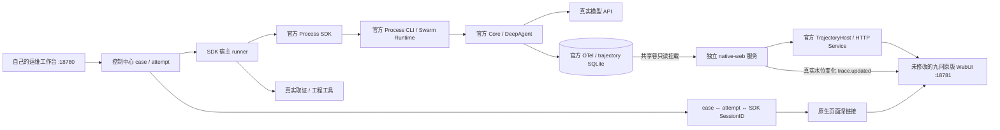

# 用九问原生 WebUI 观察同一次 SDK 任务

运维工作台在 http://127.0.0.1:18780，九问原版 WorkSwarm WebUI 在 http://127.0.0.1:18781。打开事件里的「九问原生轨迹」链接，再打开页面顶部的「轨迹分析」开关，展开 Main Agent，可看请求、模型输出、工具参数与返回、耗时和原始 OTel 记录。任务还在执行时，页面会自动增加记录。

这里展示模型公开输出和框架记录的调用数据；不声称展示模型未输出的内部思考。长日志等字段可能被上游 OTel 长度限制截断，完整取证仍以工作台中的 `ev-*` 记录为准。

## 两个页面的关系

工作台回答「哪个服务出问题、修到哪一步、PR 和发布是否成功」。九问原生页面回答「这一轮 Agent 实际问了几次模型、用了什么工具、传了什么参数、返回什么」。



**执行入口仍是 Process SDK。** 没有为了看轨迹而另开一个 Agent 执行同样的任务。修复和发布后复核各自是一轮新的 SDK Session，对应同一个 case 中的不同 attempt。CI 等待、镜像构建和发布由工程组件执行，不会冒充 Agent Span。

## 哪些是官方的，哪些是我们补的

| 部分 | 实际实现 |
|---|---|
| 页面、轨迹时间轴、模型/工具表、OTel 原始记录和导出 | 固定官方 Swarm 提交的完整前端，`npm ci && npm run build`，没有改前端源码 |
| 静态网页与反向代理 | 官方 `jiuwenswarm.channels.web.app_web` |
| WebSocket 连接、帧队列、握手与 Origin 检查 | 官方 `WebChannel` 和原生 Web 应用连接处理组件 |
| 轨迹读 API、Session 模式校验、分块响应 | 官方 `attach_trajectory_routes` / `TrajectoryHttpService` |
| SQLite / OTel 读取 | 官方 `TrajectoryHost` / `AsyncTrajectoryReader` |
| SDK 通道到浏览器的只读接线 | 我们的 `lab/native_observer.py`：读取实际 SDK Session 元数据/历史，提供必要的只读 RPC；轮询原生读取器的真实 revision/frame_seq，再发送 `trace.updated` 通知 |
| case 对应关系与跳转 | 我们的控制中心在 SDK `run.started` 等原始事件到达时记录 SessionID，工作台据此生成链接 |

这是**原版 WebUI + 官方采集/读取组件 + 自己的只读 SDK 通道适配**。没有部署完整官方 Gateway 业务应用和 AgentServer；不能称为「官方整套服务端原封不动部署」。官方完整 Web 通道本来由 AgentServer 向 Gateway 推送水位；Process SDK 没有这个常驻推送通道，因此补了这段只读传输。没有把我们的业务事件转换成 OTel Span。

## 配置与权限

- runner 独享 `.local/model.env`，调用真实模型。native-web 不挂模型文件、GitHub Token、操作令牌、Docker socket。
- runner 数据卷在 native-web 中挂为 `/recordings:ro`。原生读取器使用 `/recordings/swarm/.trace/sessions`，通过已有 SessionID 读原始数据库。
- native-web 自己的状态在独立 observer 卷；Session 元数据目录是指向原始记录的符号链接，读取显式关闭 metadata writeback。
- 仅接受 `config.get`、`models.list`、`session.list`、`session.get_metadata`、选择现有会话的 `session.switch`、`history.get`。模型名只从执行服务的公开健康接口投影，模型 Key 不共享。
- 聊天执行、删除/改名、设置修改、诊断模型调用等操作返回 `OBSERVER_READ_ONLY`。原版界面仍可能展示这些按钮；本项目没有为它们接入执行能力。
- 只绑定宿主机 `127.0.0.1`。这是本机学习环境，不是提供租户隔离的公网观测平台。

**重要的配置路径：** 固定版本的 `common.utils.get_config_file()` 实际读取 `JIUWENSWARM_DATA_DIR/config/config.yaml`。本项目将 `.local/swarm` 挂到 runner 的 `/data/swarm/config`；仅设置 `JIUWENSWARM_CONFIG_DIR` 不能代替这个目录。

```yaml
trajectory_ui:
  enabled: true
  diagnosis_enabled: true
  retention_days: 7
```

新版初始化模板已包含这些值。开启后只采集新执行的任务；此前没有采集的历史任务不会补造轨迹。升级旧环境时保留原配置，在 `.local/swarm/config.yaml` 合并此段，再执行 `scripts/lab vm-sync` 和 `scripts/lab vm-up`。先完成或停止运行中的任务；不要通过重启重放修复动作。

原有 Lima VM 还需在它自己的 `portForwards` 中增加 `guestPort: 18781 / hostPort: 18781 / hostIP: 127.0.0.1`，在没有运行任务时重启该实验 VM。新建 VM 的模板已包含。不要删除 VM 或数据卷来升级。

## 先验证最小链路

```bash
scripts/lab trace-probe
# 记下返回的 trace-probe-* 事件编号
python3 scripts/observe_native_trace.py TRACE_PROBE_ID
```

也可以在工作台点击「验证原生实时轨迹（只读）」。模型必须真实读取指标、日志、运行版本和证据；这个阶段没有源码写工具，不提交 PR、不发布。成功状态为 `TRACE_PROBE_COMPLETED`，与业务修复成功分开。这个探针规定了读取任务，用来验证集成与真实调用，不把它作为自主诊断质量或多 Agent 协作的证明。

任务一开始即可从工作台跳转，打开原生「轨迹分析」。验收必须同时满足：

1. 工作台事件中的 `sdk_runs[attempt_id].session_id` 与原生页面 URL、原生 API `session_id`、SDK 最终回执一致。
2. 任务未结束时看到 Span 和 revision 增长，不刷新页面也会更新。
3. 原生工具参数/返回含同一 case、同一 `ev-*` 证据；模型是真实供应商调用。
4. SDK 最终 `completed / exit_code=0`；没有 PR 或交付动作。

采样脚本只收集原生 HTTP 水位与事件状态，不自动声称浏览器页面验收通过。浏览器实测和截图另记。

通过后再执行 `scripts/lab agent-acceptance --trials 1`，以真实告警触发修复，并观察 repair 和 verify 两个 Session。最终应同时取得真实 PR/CI/merge/image digest、独立业务验证和 `RESOLVED_FIXED`。

## 官方源码依据（固定提交）

- [Process SDK 与通道](https://github.com/openJiuwen-ai/jiuwenswarm/blob/32d75d7d3a0b466412ee64d77c29460297515119/sdks/README.md)
- [配置路径解析 utils.py](https://github.com/openJiuwen-ai/jiuwenswarm/blob/32d75d7d3a0b466412ee64d77c29460297515119/jiuwenswarm/common/utils.py#L1700)
- [原生轨迹配置、Session 数据库路径](https://github.com/openJiuwen-ai/jiuwenswarm/blob/32d75d7d3a0b466412ee64d77c29460297515119/jiuwenswarm/observability/config.py)
- [Core 可观测性接线](https://github.com/openJiuwen-ai/jiuwenswarm/blob/32d75d7d3a0b466412ee64d77c29460297515119/jiuwenswarm/agents/harness/agent_observability.py)
- [原生水位推送协议](https://github.com/openJiuwen-ai/jiuwenswarm/blob/32d75d7d3a0b466412ee64d77c29460297515119/jiuwenswarm/observability/gateway_hints.py)
- [官方 TrajectoryHost](https://github.com/openJiuwen-ai/jiuwenswarm/blob/32d75d7d3a0b466412ee64d77c29460297515119/jiuwenswarm/server/trajectory/host.py)
- [官方 HTTP 读取组件及其注入接口](https://github.com/openJiuwen-ai/jiuwenswarm/blob/32d75d7d3a0b466412ee64d77c29460297515119/gateway/channel_manager/web/trajectory_http.py#L580)
- [原版轨迹面板及 trace.updated 订阅](https://github.com/openJiuwen-ai/jiuwenswarm/blob/32d75d7d3a0b466412ee64d77c29460297515119/jiuwenswarm/channels/web/frontend/src/features/trajectory/TrajectoryPanel.tsx#L1106)
- [原版静态 Web 服务](https://github.com/openJiuwen-ai/jiuwenswarm/blob/32d75d7d3a0b466412ee64d77c29460297515119/jiuwenswarm/channels/web/app_web.py)
- [原版前端入口](https://github.com/openJiuwen-ai/jiuwenswarm/tree/32d75d7d3a0b466412ee64d77c29460297515119/jiuwenswarm/channels/web/frontend)

Swarm/Core 的固定 SHA、许可证和来源保持上游各自所有；构建原始依赖，不把上游前端源码冒充本项目原创代码。完整版本见 `config/framework.lock.json`。
