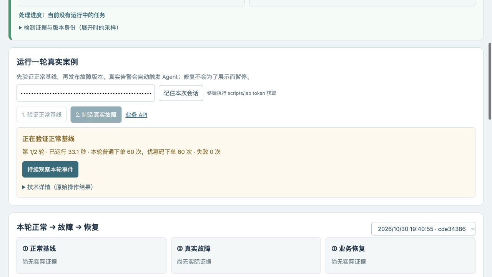
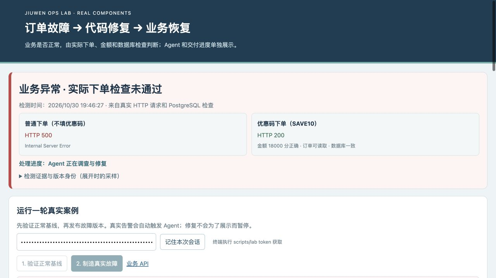
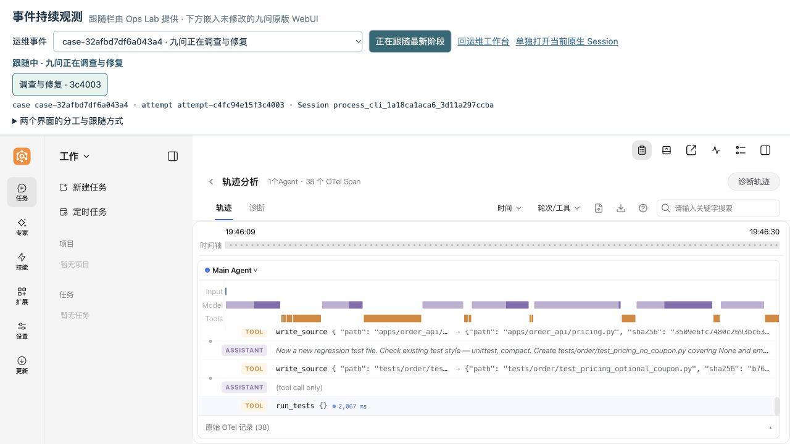
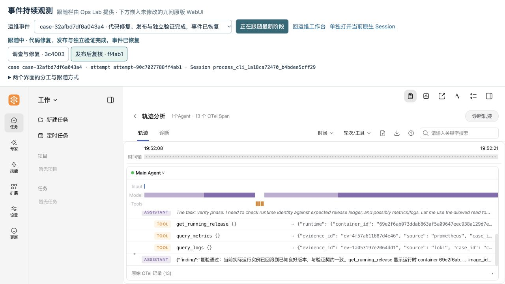
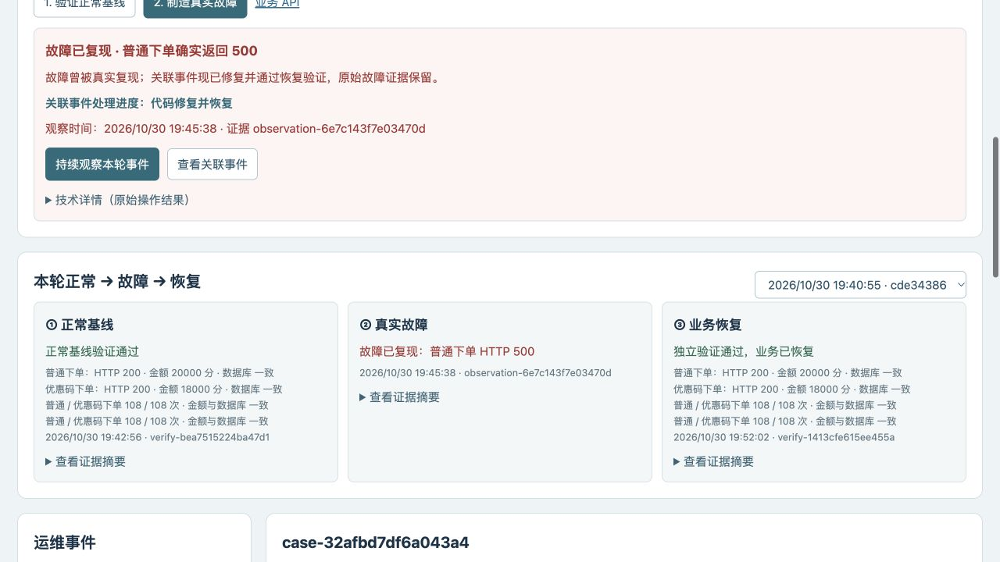

# 操作与连续观测体验验收

2026-10-30，原专用 VM 与数据卷，真实模型 `DeepSeek-V4.1-Flash-1017`。从页面执行基线与故障操作，实际告警、SDK 修复、PR/CI/发布、独立业务验证和复核完成。没有暂停 Agent 等待展示，也没有重建 VM 或清理历史。

## 本轮事实

| 项目 | 实际结果 |
|---|---|
| 实验轮次 | `experiment-82bb7025cde34386` |
| 真实事件 | `case-32afbd7df6a043a4`，最终 `RESOLVED_FIXED` |
| 基线 | `verify-bea7515224ba47d1`，2×60 秒，每轮普通/优惠码下单各 108 次，金额与数据库一致 |
| 故障 | `observation-6e7c143f7e03470d`，2026-10-30 19:45:38 北京时间，普通下单实际 HTTP 500；优惠码下单仍为 200 |
| 修复 PR | [PR #11](https://github.com/lelezi257/jiuwen-ops-lab/pull/11)，候选 `4825cd974591b0475a36e03472b945853054281d` |
| 合并与发布源码 | `d953a107b29451a9ddafb0dfb56eed5b9e35464e` |
| 构建 | [41050669226](https://github.com/lelezi257/jiuwen-ops-lab/actions/runs/41050669226)，真实产物来源与哈希校验通过 |
| 实际发布镜像 | `localhost:5000/jiuwen-order@sha256:c1f0f1e50472563285bbea79ada6ab44f2d050e828e25b57bfbdfddca7dbad36` |
| 恢复验证 | `verify-1413cfe615ee455a`，2×60 秒，每轮两条下单路径各 108 次；全部成功，数据库一致，历史订单和非法输入检查通过 |
| 模型执行 | repair 1 次、verify 1 次，均 completed / exit 0；人工重试 0、控制器错误 0 |

case 创建后 0.098 秒已记录 SDK 执行请求。故障确认操作与 Agent 领取任务独立；新增边界测试也验证 `CONFIRMING_FAULT` 不阻止 Agent 领取已排队事件。没有引入展示用暂停。

## 两个真实 Session，同一个观测页

整个案例的主观测页地址保持为：

```text
http://127.0.0.1:18781/ops-observe.html?experiment=experiment-82bb7025cde34386
```

| 阶段 | attempt | SDK / 原生 iframe Session |
|---|---|---|
| 调查与修复 | `attempt-c4fc94e15f3c4003` | `process_cli_1a18ca1aca6_3d11a297ccba` |
| 发布后复核 | `attempt-90c7027788ff4ab1` | `process_cli_1a18ca72470_b4bdee5cff29` |

主观测页从告警前等待状态自动接到修复 Session，再自动接到复核 Session；案例执行期间没有回工作台寻找第二个链接或手动切换主页面 URL。等待 CI 和独立验证的页面状态也有实际截图。

另开一个用于负向验收的历史视图，主动选择修复阶段后暂停跟随。新复核 Session 到达、主观测页已切换后，该历史视图仍保留原修复 Session；点击“继续跟随”后才转到复核 Session。另一个原先选择旧事件的观测页只显示新事件提示，没有跳走。

修复最终原生记录 51 条、revision 78；复核最终 13 条、revision 19。平台 CI/构建/发布/独立验证阶段，修复 Session 的原生 revision 保持 78；没有将平台状态转换成新的 Core Span。

## 实际截图

基线显示真实验证进度：



实际业务异常与 Agent 调查分别展示：



同一观测页中的真实修复工具调用：



同一页面自动接到新的复核 Session：



恢复后仍保留本轮三段真实证据，默认 JSON 折叠：



## 逐项核查材料

- [实验、状态时间线与验收断言](evidence/experience-ui/acceptance.json)
- [真实 PR/CI/发布/业务合同及 SDK 回执摘要](evidence/experience-ui/full-case.json)
- [原生轨迹与真实 Session 对应、原生归档及哈希](evidence/experience-ui/native-trace-summary.json)
- [主观测页修复阶段](evidence/experience-ui/browser-repair.json)、[等待 CI](evidence/experience-ui/browser-ci.json)、[等待独立验证](evidence/experience-ui/browser-delivery-wait.json)、[自动接到复核](evidence/experience-ui/browser-verify.json)
- [历史选择前](evidence/experience-ui/history-before-new-stage.json)、[新阶段到达仍保持历史](evidence/experience-ui/history-after-new-stage.json)、[用户主动继续跟随](evidence/experience-ui/history-resumed.json)
- [新事件提示而不抢走旧事件](evidence/experience-ui/new-event-discovery.json)
- [默认 JSON 全部折叠，技术详情可读且 max-height=240px / overflow-y=auto](evidence/experience-ui/technical-details.json)
- [原生只读边界与真实水位](evidence/experience-ui/native-readonly-boundaries.json)
- [原版前端 1,550 个源文件与入口资源哈希核对](evidence/experience-ui/frontend-provenance.json)

空令牌的真实按钮请求返回明确的“操作令牌无效”及获取命令，没有创建操作、发布故障或调用模型；相关截图保存为 `failure-human-message.jpg`。

辅助 round 采样脚本在第一个 case 尚无 Session 时遇到空值，随后修复了空值处理，读取同一轮持久状态并保留此前采样；没有重新跑故障，也没有补造中间采样。完整阶段以原始 case 事件、独立报告、原生轨迹采样和实际浏览器身份记录核查。

## 实现边界与复现

31 项产品边界测试通过；独立 `scripts/ci.py --candidate . --trusted .` 的真实 HTTP/数据库合同通过。原版轨迹组件、源文件、执行链均保留；新增的是明确标注的事件跟随栏和业务/操作证据展示。

完整操作步骤、原生能力核查、接口和扩展边界见 [操作与持续观测](OPERATOR-EXPERIENCE.md)。这次验证一个受控订单案例，未扩展为生产可靠性或多 Agent 协作结论。
